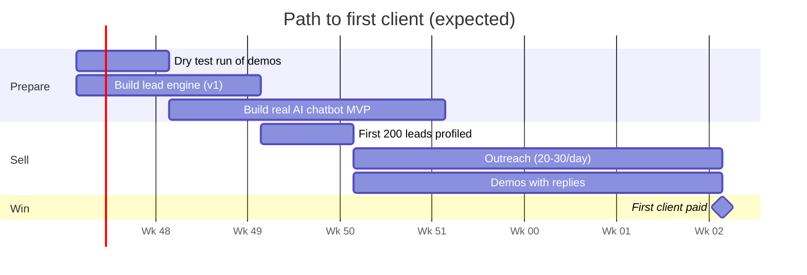

# Project Handover: Managed Tech Services Business

| | |
|---|---|
| **Document type** | Project handover and business plan |
| **Version** | 3.1 (replaces v1, v2 and v3.0) |
| **Date** | 24 November 2026 |
| **Base** | Newcastle, NSW, Australia |
| **Status** | Direction agreed · first niches chosen · two demos built · lead engine designed, not built · no clients yet |
| **Files** | `ai-receptionist/` folder, git branch `ccr-dc5207a9-w25myz` |
| **Currency** | AUD unless marked USD. All third-party prices are approximate, so check them before quoting. |

> **For the next AI or person taking over:** the owner wants **plain English**, honest advice and clear steps. The hard rules are **$0 upfront, very low running costs, and the highest margin possible, short term to long term**. Read the document in order. Each section starts with a short intro, builds on the one before it, and links to related sections.

### Key to symbols
| Symbol | Meaning |
|---|---|
| ★★★★★ → ★☆☆☆☆ | Ideal → avoid |
| ✅ / ⚠️ / ❌ | Use now / later or with care / don't use |
| 💬 | Figure **discussed in the chat** |
| 💡 | Figure **suggested in this document** (to be tested) |

---

## Contents
**Part A: Starting point**
1. [Executive summary](#1-executive-summary)
2. [The owner and the brief](#2-the-owner-and-the-brief)
3. [Discussion record](#3-discussion-record)

**Part B: The business**
4. [The problem we solve](#4-the-problem-we-solve)
5. [The business model: server + app + maintenance](#5-the-business-model)
6. [Why servers add value](#6-why-servers-add-value)
7. [The apps we can sell](#7-the-apps-we-can-sell)
8. [White label explained](#8-white-label-explained)
9. [Positioning](#9-positioning)

**Part C: Market and clients**
10. [Niches, ranked](#10-niches-ranked)
11. [Clients](#11-clients)
12. [Starting offer and add-ons](#12-starting-offer-and-add-ons)

**Part D: The money**
13. [Pricing](#13-pricing)
14. [Our costs](#14-our-costs)
15. [Our side vs the client's side](#15-our-side-vs-the-clients-side)
16. [Margins and profit](#16-margins-and-profit)
17. [Workload](#17-workload)
18. [Time to first client](#18-time-to-first-client)
19. [Projections](#19-projections)
20. [Is it profitable? Verdict and decisions](#20-is-it-profitable)
21. [Other options compared](#21-other-options-compared)

**Part E: Doing it**
22. [Tools and sources, rated](#22-tools-and-sources-rated)
23. [The lead engine](#23-the-lead-engine)
24. [What's built: demos and dry test run](#24-whats-built)
25. [Roadmap](#25-roadmap)
26. [Scope](#26-scope)
27. [Risks and compliance](#27-risks-and-compliance)
28. [Handover rules and next actions](#28-handover-rules-and-next-actions)

---

# Part A: Starting point

## 1. Executive summary

*This section answers the main question first: is this worth doing? Everything after it explains and backs up these answers.*

**Short answer: yes.** It costs **$0 to start**, has **very low running costs**, and keeps **about 75–95% of every dollar** a client pays as profit. Income repeats monthly. The limits are **finding clients** and **the owner's time**, not money.

| Question | Answer | Details |
|---|---|---|
| The business | We **set up, host and run** tech that local businesses need (websites, booking systems, AI chatbots, automations, internal tools) on **our own cheap servers**, for a **monthly fee** | [§5](#5-the-business-model) |
| Upfront cost | **$0.** Each client pays before we spend. | [§5.2](#52-how-money-flows-with-0-upfront) |
| Running cost | **$0–40 a month** fixed at the start, plus about $3–25 per client | [§14](#14-our-costs) |
| Margin | **75–95%** per client | [§16](#16-margins-and-profit) |
| Client saves vs alternatives | Typically **$100–2,400 a month** | [§15](#15-our-side-vs-the-clients-side) |
| First niches | **Barbers & salons** and **allied health clinics**, equal first | [§10](#10-niches-ranked) |
| Time to first client | **Expected 6–8 weeks** (best 3–4, slow 10–12) | [§18](#18-time-to-first-client) |
| Year 1 (expected, 10–15 hrs a week) | **22 clients**, **$2,640 a month** recurring by month 12, **≈ $17.7k profit** | [§19](#19-projections) |
| Long run (years 2–3) | **$4–8k a month profit** with 40–60 clients | [§19.5](#195-stage-3-long-run-years-23) |
| Biggest risk | Not enough clients. The fix is an automated lead engine. | [§23](#23-the-lead-engine) |

---

## 2. The owner and the brief

*Before planning anything, we need to be clear about who is doing this and what they asked for. Every later decision is checked against this section.*

### 2.1 The brief, in the owner's words
> "I'm looking for a low cost business model where I can rent out servers or something like that without any upfront cost.
>
> I'm broke atm and I can build systems - meaning I'm technology driven via coding and ai.
>
> What's my best bet ?"

By "rent out servers" they meant **wholesale, reselling or white label**.

### 2.2 The brief, stated precisely
| Requirement | What it means for the plan |
|---|---|
| **No upfront cost** | Nothing is bought until a client pays ([§5.2](#52-how-money-flows-with-0-upfront)) |
| **Very low running costs** | Shared servers, free tiers, pay-per-use only ([§14](#14-our-costs)) |
| **Highest margin, short to long run** | Recurring fees with costs that barely grow per client ([§16](#16-margins-and-profit)) |
| **Servers / white label** | Infrastructure is the base of the business ([§6](#6-why-servers-add-value), [§8](#8-white-label-explained)) |
| **Use the owner's assets** | **Time, skills and energy**: coding, AI, building systems |

### 2.3 The owner
| Item | Detail |
|---|---|
| Money | None to invest |
| Skills | Python, JavaScript, React, Docker, Linux, AI, security and bug bounty background |
| Time | **10–15 hours a week minimum**, varies ([§17](#17-workload)) |
| Location / transport | Newcastle NSW · public transport only |
| Registration | **ABN active** |
| Style | Plain English, step by step |

---

## 3. Discussion record

*This section records how the conversation turned the brief in [§2](#2-the-owner-and-the-brief) into a direction: what the owner asked, what was suggested, and what was agreed. Later sections build on these decisions.*

### 3.1 Key discussions
| # | Topic | Owner said | Suggested | Decision |
|---|---|---|---|---|
| 1 | Best bet | Rent out servers, no upfront cost | **"Don't rent servers. Rent outcomes that happen to run on servers."** Set up and run something a business needs, host it on a $5–20 VPS, charge $50–300 a month. 💬 | ✅ "Seems good" |
| 2 | What to sell | — | AI chatbot · automation (n8n) · managed open-source apps · micro-SaaS later | ✅ Becomes the app menu ([§7](#7-the-apps-we-can-sell)) |
| 3 | What to avoid | — | Buying GPUs or servers · plain hosting resale · building before anyone has paid | ✅ |
| 4 | White label | "I meant wholesale / white label" | Plain hosting is a commodity, so **wrap the server in a service** | ✅ **"Server + app + maintenance"** ([§5](#5-the-business-model)) |
| 5 | No capital | "Only time and skills" | Free demo → paid upfront → then rent the server | ✅ $0-upfront rule |
| 6 | Website | "Do I need one?" | Not at first. Later a free-hosted one-page site. | ✅ |
| 7 | Location | Newcastle, public transport | Online outreach first, visits along transport routes | ✅ |
| 8 | Niche | "Bookings oriented", "do a barber" | Barber as the first demo. Sell what **fills** bookings, not another booking app. | ✅ ([§10](#10-niches-ranked)) |
| 9 | AI | "Is it just a chatbot?" | The demo is scripted. The product uses real AI. | ✅ |
| 10 | No bookings | "What if they don't do bookings?" | Sell another app, or skip them | ✅ |
| 11 | Phone | "Let's do that" | Phone demo built | ✅ **Phone = add-on** ([§12](#12-starting-offer-and-add-ons)) |
| 12 | Install | "Need their code?" | No. One pasted line, or a link, QR code or social media. | ✅ |
| 13 | Leads | Owner's idea: automate finding and profiling leads, emails, a tracker | Lead engine design | ✅ ([§23](#23-the-lead-engine)) |

### 3.2 Concerns and where they're handled
| Concern | Handled in |
|---|---|
| No money | [§5.2](#52-how-money-flows-with-0-upfront), [§22](#22-tools-and-sources-rated) |
| No car | [§23](#23-the-lead-engine) (online, automated), [§11.6](#116-where-clients-are-no-car) |
| Is it real AI? | [§24](#24-whats-built) |
| Businesses without bookings | [§7](#7-the-apps-we-can-sell), [§11.4](#114-objections-and-answers) |
| Their website code | [§11.5](#115-onboarding-from-yes-to-live) |
| Existing tools and competitors | [§23.6](#236-profiler-and-scoring) |

---

# Part B: The business

## 4. The problem we solve

*Before choosing a model, we need to know what businesses will pay to fix. This section lists their problems. [§5](#5-the-business-model) shows how we fix them profitably.*

Small businesses need technology but **don't have the time, skills or staff** to set it up and run it.

| Problem | What it costs them | Our app ([§7](#7-the-apps-we-can-sell)) |
|---|---|---|
| Missed calls and messages | Lost customers and bookings | AI chatbot, phone add-on |
| Manual bookings, no-shows | Admin time, lost income | Booking system, reminders |
| Old or missing website | Not found, looks unprofessional | Managed website |
| Repetitive admin | Hours every week | Automation workflows |
| Spreadsheets and paper | Errors, wasted time | Internal tools |
| Tech breaks, nobody to fix it | Stress, downtime | Maintenance |
| Many tools that don't connect | Cost and confusion | One provider, connected |

**In one line:** they want results (more customers, less admin), not tech. We take the tech off their hands.

---

## 5. The business model

*This is the core of the plan: how we fix the problems in [§4](#4-the-problem-we-solve) and make money doing it.*

### 5.1 Server + app + maintenance
> **We set up and run something a business needs (a website, booking system, internal tool, AI chatbot or automation workflow), host it on a cheap VPS ($5–20 a month), and charge a monthly retainer ($50–300 a month per client).** 💬

```
SERVER (we rent & share) + APP (what they need) + MAINTENANCE (we look after it) = one monthly fee
```

| Part | What it is | Paid by |
|---|---|---|
| **Server** | A cheap online computer shared by many clients ([§6](#6-why-servers-add-value)) | Client fees |
| **App** | The tool they need ([§7](#7-the-apps-we-can-sell)) | Setup fee |
| **Maintenance** | Updates, fixes, small changes, support | Monthly fee |

### 5.2 How money flows with $0 upfront
```
Free demo → client says yes → client pays setup + month 1 → we rent/extend server → monthly fee is mostly profit
```
We never spend before we're paid. Each new client on the same server costs only a few dollars, which is where the margin in [§16](#16-margins-and-profit) comes from.

---

## 6. Why servers add value

*The owner's original idea was servers. This section explains, in plain English, why the server is what makes the model in [§5](#5-the-business-model) profitable.*

**Plain English:** the server is the shop where the client's tools live. Because we run the shop, the client pays us every month, and we can fit many clients into one cheap shop.

| Without our own server | With our own server |
|---|---|
| Paid once for building something | **Paid every month** for hosting and looking after it |
| The client pays 5 separate subscriptions | The client pays us one fee |
| Each client costs us a full tool subscription | **Many clients share one $5–20 server** |
| Hard to fix or update | We update, fix and back up everything centrally |
| The client leaves easily | Moving away is effort, so they **stay longer** |
| Other companies set the price | **We set the price and keep the margin** |

**In short:** recurring income · margin · control · loyalty. It's the "rent out servers" idea, sold as a full service. See [§14.2](#142-fixed-costs-shared-by-all-clients) for how server cost is spread across clients.

---

## 7. The apps we can sell

*The server is the shop. The apps are what's on the shelves. Each one solves a problem from [§4](#4-the-problem-we-solve) and is priced in [§13](#13-pricing).*

| App | What it does | How we build it | Setup effort | Best niches | Rating |
|---|---|---|---|---|---|
| **AI chatbot** | Answers 24/7, captures leads, books | Our code + AI API | Medium | Salons, clinics, trades | ★★★★★ |
| **Booking system** | Online bookings, calendar, reminders | Cal.com or our own | Low–med | Salons, clinics, tutors | ★★★★★ |
| **Automation workflows** | Invoices, follow-ups, form → sheet, reminders | n8n | Low–med | Everyone | ★★★★★ |
| **Managed website** | Fast, professional site kept up to date | Static site or WordPress | Low | Everyone | ★★★★☆ |
| **Internal tools** | Job trackers, dashboards, rosters, stock | React + database | Med–high | Trades, retail, offices | ★★★★☆ |
| Reviews & reputation | Asks for Google reviews | Automation + SMS/email | Low | Everyone | ★★★★☆ |
| Reactivation | "Time for your next visit" | Automation | Low | Salons, dental, physio | ★★★★☆ |
| **Phone AI (add-on)** | Answers calls by voice, books | Vapi/Retell + our server | Medium | Clinics, trades, salons | ★★★★☆ |
| Security checks (add-on) | Monthly website security check | The owner's security skills | Low | Anyone with a site | ★★★★☆ |
| Managed open-source apps | Nextcloud, Umami, Uptime Kuma | Docker | Low | Offices | ★★★☆☆ |
| Micro-SaaS (later) | One product for one niche | Own product | High | One niche | ★★★☆☆ |

**Bundles:** clients with several apps pay more and stay longer. [§16.3](#163-portfolio-view-10-clients) shows the effect on profit.

---

## 8. White label explained

*The owner asked about white label. This section explains what it is, what it costs, and whether it fits the free-first model in [§5](#5-the-business-model).*

**White label** means a company makes a product and lets you sell it **under your own name**. There are two directions:

| Direction | Meaning | When |
|---|---|---|
| **A. We buy white label** | Rent someone's platform, rebrand it, resell it | Only if it saves real time, and only once clients pay |
| **B. We are the white-label provider** | Agencies resell **our** platform under their brand | Long run ([§25](#25-roadmap) phase 6) |

### 8.1 Direction A: options, costs, ratings
| Option | You get | Approx. cost | Model | Rating | Verdict |
|---|---|---|---|---|---|
| Reseller hosting (ResellerClub, Hostinger, cPanel) | Web space to resell | $15–40 a month | Sell plans for $5–15 | ★★☆☆☆ | ❌ Commodity. Our VPS is better. |
| GoHighLevel agency | CRM, booking, chat, SMS, white label | USD $97–497 a month | Rebrand, charge $100–300 | ★★★☆☆ | ⚠️ Only at 10+ clients |
| White-label chatbot platforms (Chatbase, Botpress etc.) | Ready-made bots | USD $40–500 a month | Rebrand per client | ★★☆☆☆ | ❌ We build our own cheaper |
| Voice AI (Vapi, Retell) | Voice engine | Cents per minute | Inside the phone add-on | ★★★★☆ | ✅ Phone add-on only |
| White-label site builders (Duda etc.) | Agency site builder | USD $20–100+ a month | Build client sites | ★★☆☆☆ | ❌ Static sites are free |

**Cost comparison for 10 chatbot clients:**
| | Buy white label (e.g. a chatbot platform) | Build our own |
|---|---|---|
| Platform cost | About $150–450 a month | $0 |
| Server | Included | $10–20 a month |
| AI usage | Often included or capped | About $50–150 a month |
| **Total cost** | **≈ $150–450 a month** | **≈ $60–170 a month** |
| Upfront | Pay from day 1 | **$0** |
| **Verdict** | | ✅ **Build our own** |

### 8.2 Direction B: us as the provider (long run)
| Item | Detail |
|---|---|
| Ideal partners | Freelance web designers, small marketing agencies, IT support businesses, business coaches |
| They pay us | 💡 $40–60 per client a month (wholesale) |
| They charge their client | $100–200 a month |
| Our cost per client | About $10–20 |
| **Our margin** | **≈ $30–45 per client, with no selling work** |
| When | After 15–20 direct clients ([§25](#25-roadmap)) |

---

## 9. Positioning

*With the model ([§5](#5-the-business-model)) and the apps ([§7](#7-the-apps-we-can-sell)) set, this section covers how we present ourselves so the right clients ([§11](#11-clients)) say yes.*

| Element | Statement |
|---|---|
| Who we are | A local Newcastle tech partner for small businesses |
| What we do | We set up, host and look after the tech that brings you customers and saves you admin |
| For whom | Busy owner-run businesses, 1–20 staff, no IT person |
| Promise | **"You run your business. We run your tech."** |
| Versus agencies | Local, cheaper, monthly, one contact, no jargon |
| Versus DIY apps | Done for you, connected, looked after, AI built in |
| Versus existing tools | **We add to what they already have and connect it, not replace it** ([§23.6](#236-profiler-and-scoring)) |

---

# Part C: Market and clients

## 10. Niches, ranked

*We can't sell to everyone at once. This section ranks types of business so we start where sales come easiest and pay best. [§11](#11-clients) then describes those clients in detail.*

**Scoring:** 1–5 on pain, budget, speed to sell, fit with our apps, reach without a car, and low compliance risk.

| Rank | Niche | Pain | Budget | Speed | Fit | Reach | Risk | **/30** | Status |
|---|---|---|---|---|---|---|---|---|---|
| **1=** | **Barbers & salons** | 4 | 3 | 5 | 5 | 5 | 5 | **27** | ✅ Start (demo built) |
| **1=** | **Allied health clinics** | 5 | 5 | 3 | 5 | 4 | 3 | **25** | ✅ Start in parallel |
| 3 | Trades | 5 | 4 | 4 | 4 | 3 | 5 | **25** | ⚠️ Next |
| 4 | Dental | 5 | 5 | 2 | 4 | 4 | 3 | **23** | ⚠️ Later |
| 5 | Vets & groomers | 4 | 4 | 3 | 4 | 4 | 4 | **23** | ⚠️ Later |
| 6 | Gyms & PTs | 3 | 3 | 4 | 4 | 4 | 5 | **23** | ⚠️ Later |
| 7 | Driving schools, tutors, mechanics | 4 | 2 | 4 | 4 | 4 | 5 | **23** | ⚠️ Later |
| 8 | Real estate | 3 | 5 | 2 | 3 | 4 | 4 | **21** | ❌ Long sales cycle |
| 9 | Restaurants & cafes | 3 | 2 | 3 | 3 | 5 | 5 | **21** | ❌ Low budget |

*Salons lead on speed, clinics on value. Both are run in parallel and compared after 100 contacts each ([§20.3](#203-which-niche-to-keep)).*

---

## 11. Clients

*This section is about the people we sell to: who they are, how they decide, what worries them, how we bring them on board, and how we keep them. It builds on the niches in [§10](#10-niches-ranked) and feeds the lead engine's targeting in [§23](#23-the-lead-engine).*

### 11.1 Ideal client profile
| Trait | Ideal | Avoid |
|---|---|---|
| Size | 1–20 staff, owner-run | Chains and franchises (head office decides) |
| Business | Takes bookings or enquiries | Pure walk-in with no online presence and no interest |
| Online | Has a website or an active Google/Instagram listing | Totally offline |
| Reviews | 20–300 Google reviews (established, still independent) | Brand new or very large |
| Tools | No assistant, or a basic human-only chat | Already has an advanced AI receptionist |
| Attitude | Busy, values time, open to help | "Tech is a scam" |

### 11.2 Client personas
| Persona | Example | What they care about | What we lead with |
|---|---|---|---|
| **Busy barber/salon owner** | 3-chair barber on Beaumont St | Not missing DMs and calls mid-cut, fewer no-shows | Chatbot + Instagram + reminders |
| **Clinic owner/manager** | 4-practitioner physio in Charlestown | Reception overload, after-hours enquiries, new patients | Chatbot for enquiries + new-patient requests, phone add-on |
| **Tradie** (next niche) | Solo plumber | Missing jobs while on the tools | Phone add-on + quote intake |

### 11.3 How a client decides
| Stage | What they think | What we do |
|---|---|---|
| Aware | "I do miss messages…" | Personal email naming their gap ([§23.9](#239-outreach-sequencer)) |
| Interested | "Would it work for me?" | **A demo with their own name and services** ([§23.10](#2310-personalised-demo-generator)) |
| Considering | "What does it cost? Is it hard?" | Clear price, no tech work for them, compared with their alternatives ([§15](#15-our-side-vs-the-clients-side)) |
| Deciding | "Is it risky?" | Founder discount, month-to-month, cancel anytime |
| Buying | "OK" | Invoice for setup + month 1 (Stripe) |

### 11.4 Objections and answers
| Objection | Answer |
|---|---|
| "I already use Fresha / HotDoc" | "Great, keep it. We answer the people who message you and send them to your booking page." |
| "I don't have time to set it up" | "You don't need to. Give us 20 minutes and we do the rest." |
| "AI will say something wrong" | "It only uses your info, never makes up times, and hands over to you when unsure." |
| "Too expensive" | "One extra booking a week covers it." ([§15](#15-our-side-vs-the-clients-side)) |
| "We don't do bookings" | "It still answers questions and captures enquiries, or we can help with reviews and your website." |
| "Is my customers' data safe?" | "Minimal data, stored securely, never sold." ([§27](#27-risks-and-compliance)) |

### 11.5 Onboarding: from yes to live
| Step | What | Time |
|---|---|---|
| 1 | Invoice paid (setup + month 1) | — |
| 2 | 20-minute call or form: services, prices, hours, FAQs, booking link, notification contact | 20–30 min |
| 3 | Configure their assistant from the template | 1–3 hrs |
| 4 | Test 20 typical questions | 30 min |
| 5 | Install: one line on their site, or a link/QR code, or social media connections | 15–30 min |
| 6 | Go live and send them a "how it works" sheet | 15 min |
| 7 | Week-1 check-in | 15 min |

### 11.6 Where clients are (no car)
| Area | Transport | Salons | Clinics |
|---|---|---|---|
| Newcastle CBD / Hunter St | Light rail | Many | Several |
| Darby St, Cooks Hill | Bus / walk | Many | Several |
| Beaumont St, Hamilton | Train / bus | Many | Some |
| Charlestown, Kotara | Bus | Many | Many |
| Maitland | Train | Many | Many |
| Lake Macquarie centres | Bus | Many | Many |

### 11.7 Keeping clients (retention)
| Action | When | Why |
|---|---|---|
| Monthly report: enquiries handled, bookings made, after-hours chats | Monthly | Shows the value in numbers |
| Quick fixes (under 24 hrs) | Always | Trust |
| Offer one new add-on | Every 3 months | Grows the fee ([§12](#12-starting-offer-and-add-ons)) |
| Ask for a review or referral | After month 2 | New clients |
| Referral reward | 💡 One month free per referral | Cheap growth |

---

## 12. Starting offer and add-ons

*This section turns the client needs in [§11](#11-clients) into a specific first offer, then adds the extras that raise income per client over time.*

**Starting offer (both niches):** *"Never miss a booking or enquiry again."* An AI chatbot that answers 24/7, captures details, and books or sends booking requests. Set up, hosted and looked after by us.

| Add-on | What it adds | Best niche |
|---|---|---|
| **Phone AI** | Answers missed or after-hours calls | Clinics, trades, salons |
| Reminders | Fewer no-shows | Clinics, salons |
| Reviews | More Google reviews | Everyone |
| Reactivation | Brings back past customers | Salons, clinics |
| Managed website | New or rebuilt site | Weak or no website |
| Automation pack | Admin automated | Clinics, trades |
| Security check | Monthly site check | Everyone |

**Land and expand:** start with one app and add more over time. This is why the average fee rises in [§19](#19-projections).

---

# Part D: The money

## 13. Pricing

*This section sets what we charge and explains why. [§14](#14-our-costs) covers what it costs us, and [§16](#16-margins-and-profit) shows what's left.*

### 13.1 Pricing principles
| Principle | Why |
|---|---|
| Setup fee upfront | We never spend first |
| Monthly retainer | Recurring income for hosting, maintenance and support |
| Price on value | One extra booking a week is worth $40–150+ to them |
| Founder discount (first 3) | Easier first sales, plus testimonials |
| Usage caps (AI, phone) | Protects the margin |

### 13.2 Price list
| Service | Setup | Monthly | Source |
|---|---|---|---|
| General model (any app) | — | **$50–300** | 💬 |
| Early example quote | $200 | $100 | 💬 |
| **Chatbot + bookings (starting offer)** | **$300** ($150 first 3) | **$99–149** | 💬 |
| Managed website | $300–800 | $50–80 | 💡 |
| Booking system only | $200–300 | $50–99 | 💡 |
| Automation workflow | $200–500 each | $50–150 | 💡 |
| Internal tool | $500–1,500 | $100–300 | 💡 |
| Managed open-source app | $100–200 | $30–100 | 💡 |
| **Phone AI add-on** | +$150 | +$99–199 (minutes included) | 💡 |
| Reminders / reviews / reactivation | +$0–100 | +$29–59 each | 💡 |
| Security check | — | +$29–49 | 💡 |

### 13.3 Why these prices
- **$99–149 a month** is far below a receptionist and close to what single DIY tools cost, but we do the work ([§15](#15-our-side-vs-the-clients-side)).
- **The $300 setup** is easy to say yes to, filters out time-wasters, and covers early server costs.
- **The phone add-on is priced higher** because voice is charged per minute ([§14.3](#143-per-client-costs-by-package)).

---

## 14. Our costs

*Prices from [§13](#13-pricing) mean nothing without costs. This section lists every cost on our side: one-off, fixed, and per client.*

### 14.1 One-off costs
| Item | Cost | When |
|---|---|---|
| Domain | About $15–25 a year (💬 about $10 quoted) | After the first client, or when outreach needs it |
| ABN | $0 | ✅ Done |
| Brand / logo | $0 (DIY) | Anytime |
| **Total before the first client** | **$0** | |

### 14.2 Fixed costs (shared by all clients)
| Stage | Clients | Server | Email/tools | **Total a month** | **Per client** |
|---|---|---|---|---|---|
| Demo | 0 | $0 | $0 | **$0** | — |
| Start | 1–5 | $0–10 | $0 | **$0–10** | $2–10 |
| Growing | 6–15 | $10–20 | $0–10 | **$10–30** | ≈ $2 |
| Established | 16–40 | $20–60 | $10–30 | **$30–90** | ≈ $2 |
| Large | 40+ | $60–150 | $30–60 | **$90–210** | ≈ $2–3 |

**The more clients we have, the cheaper each one is to serve.** That's the server advantage from [§6](#6-why-servers-add-value).

### 14.3 Per-client costs by package
| Cost item | Website | Chatbot + bookings | Chatbot + 2 add-ons | Chatbot + phone AI |
|---|---|---|---|---|
| Server share | $1.50 | $2.00 | $2.50 | $2.50 |
| AI usage | $0 | $8.00 | $10.00 | $10.00 |
| SMS / email | $0 | $1.00 | $5.00 | $5.00 |
| Voice minutes + number | $0 | $0 | $0 | $45.00 |
| Payment fees (about 2%) | $1.30 | $2.60 | $4.00 | $5.60 |
| Backups / monitoring | $0.20 | $0.40 | $0.50 | $0.50 |
| **Total our cost a month** | **$3.00** | **$14.00** | **$22.00** | **$68.60** |

*AI and voice vary with usage. Caps keep them within these ranges.*

---

## 15. Our side vs the client's side

*This section puts the two sides next to each other: what a client would pay to solve the problem another way, versus what they pay us and what it costs us. It's the main argument in sales ([§11.4](#114-objections-and-answers)) and the reason the margins in [§16](#16-margins-and-profit) hold up.*

### 15.1 Client's options for "answer enquiries and book customers"
| Option | Monthly cost to the client (approx.) | Their time each month | Works 24/7? | Done for them? |
|---|---|---|---|---|
| Part-time receptionist (about 20 hrs a week) | **$2,400–2,800** (wages + super) | Managing staff | ❌ | ✅ |
| Phone answering service | **$150–400** + per-call fees | Low | ⚠️ Messages only | ✅ |
| DIY tools (chat widget + automation + booking app) | **$60–150** | **4–8 hrs** setting up and fixing | ⚠️ Basic | ❌ |
| Do nothing | $0 | — | ❌ | — |
| | **Missed: about 2–5 bookings a week × $40–150 = $350–3,000 lost a month** | | | |
| **Us: chatbot + bookings** | **$129** | **≈ 0 hrs** | ✅ | ✅ |

### 15.2 Side-by-side: one chatbot + bookings client
| | **Client's side** | **Our side** |
|---|---|---|
| Pays / receives each month | Pays **$129** | Receives **$129** |
| Real cost | $129 | **$14** ([§14.3](#143-per-client-costs-by-package)) |
| Setup | Pays $300 once | Receives $300, about 3–6 hrs of work |
| Alternative they avoid | DIY $100 + 6 hrs (≈ $400 incl. time) or receptionist ≈ $2,600 | — |
| **Gain each month** | **Saves ≈ $270–2,470** + recovers lost bookings | **Profit $115** |
| Year 1 total | Pays $300 + $1,548 = **$1,848** | Profit $300 + $1,380 = **$1,680** |

### 15.3 Comparison across packages
| Package | Client pays a month | Client's cheapest alternative | **Client saves** | Our cost | **Our profit** | **Our margin** |
|---|---|---|---|---|---|---|
| Managed website | $65 | Website builder $30 + 3 hrs of their time (≈ $180) | **≈ $115** | $3 | **$62** | **95%** |
| Chatbot + bookings | $129 | DIY $100 + 6 hrs (≈ $400) | **≈ $270** | $14 | **$115** | **89%** |
| Chatbot + 2 add-ons | $199 | DIY $180 + 8 hrs (≈ $580) | **≈ $380** | $22 | **$177** | **89%** |
| Chatbot + phone AI | $279 | Answering service $300 + DIY $100 (≈ $400) | **≈ $120** (and covers 24/7) | $69 | **$210** | **75%** |

*Their time is valued at about $50 an hour. **Both sides win:** the client pays less than their alternatives, and we keep 75–95%.*

---

## 16. Margins and profit

*This section turns prices ([§13](#13-pricing)) minus costs ([§14](#14-our-costs)) into clear margins and profits: per client, across a group of clients, and over a client's lifetime.*

### 16.1 Per client, per month
| Package | Price | Cost | **Profit** | **Margin** |
|---|---|---|---|---|
| Managed website | $65 | $3 | **$62** | **95%** |
| Chatbot + bookings | $129 | $14 | **$115** | **89%** |
| Chatbot + 2 add-ons | $199 | $22 | **$177** | **89%** |
| Chatbot + phone AI | $279 | $69 | **$210** | **75%** |

### 16.2 Setup fee profit
| | Founder price | Standard |
|---|---|---|
| Setup fee | $150 | $300 |
| Cost (our time is not counted, tools $0) | $0 | $0 |
| Hours | 6–10 early | 2–4 later |
| **Profit per hour** | **$15–25** | **$75–150** |

### 16.3 Portfolio view (10 clients)
| Mix | Monthly income | Monthly cost (incl. fixed $20) | **Monthly profit** | **Margin** |
|---|---|---|---|---|
| 10 × chatbot + bookings | $1,290 | $160 | **$1,130** | **88%** |
| 6 chatbot + 2 with add-ons + 2 with phone | $1,730 | $286 | **$1,444** | **83%** |
| 4 websites + 6 chatbots | $1,034 | $116 | **$918** | **89%** |

### 16.4 Lifetime value per client
| Item | Value |
|---|---|
| Average monthly profit | ≈ $115 |
| Average stay (about 4% leave each month) | ≈ 24 months |
| Monthly profit over a lifetime | ≈ $2,760 |
| Setup profit | ≈ $250 |
| **Lifetime profit per client** | **≈ $3,000** |

**What this means:** every client won is worth about **$3,000**, which justifies the effort on leads in [§23](#23-the-lead-engine).

---

## 17. Workload

*Money isn't the limit, time is. This section shows what the work actually involves at 10–15 hours a week, which sets the realistic client numbers used in [§18](#18-time-to-first-client) and [§19](#19-projections).*

### 17.1 Types of work
| Work | Involves | Early | Later (templates and automation) |
|---|---|---|---|
| Building the platform | Chatbot, widget, dashboard | 30–50 hrs once | Small updates |
| Lead engine | Build it once, then check results | 15–25 hrs once, then 1–2 hrs a week | 1 hr a week |
| Outreach | Replies, follow-ups | 3–4 hrs a week | 2 hrs a week |
| Demos / sales | Calls, visits, proposals | 1–2 hrs per prospect | 1 hr |
| Client setup | [§11.5](#115-onboarding-from-yes-to-live) | 6–10 hrs per client | 2–4 hrs |
| Maintenance | Updates, fixes, reports | 1–1.5 hrs per client a month | 0.5 hrs |
| Admin | Invoices, bookkeeping | 1 hr a week | 1 hr a week |

### 17.2 A 12-hour week by stage
| Stage | Build | Sales | Setups | Maintenance | Admin | **Total** |
|---|---|---|---|---|---|---|
| Months 1–2 | 6 | 5 | 0 | 0 | 1 | **12** |
| Months 3–6 | 2 | 5 | 3 | 1–2 | 1 | **12–13** |
| Months 7–12 | 1 | 4 | 3 | 3–5 | 1 | **12–14** |

### 17.3 Capacity
At 10–15 hours a week: **2–3 new clients a month** and **25–30 clients in total** before maintenance crowds out sales. Going beyond that needs automation, more hours or help.

---

## 18. Time to first client

*Using the workload in [§17](#17-workload) and the lead engine's funnel ([§23.12](#2312-metrics-and-funnel)), this section maps the path from today to the first paying client, week by week.*

### 18.1 Timeline (expected case)


### 18.2 Week by week
| Week | Focus | Output | Running total |
|---|---|---|---|
| 1 | Dry test run · start lead engine | Demos recorded | 0 leads |
| 2 | Finish lead engine v1 · domain + email (if needed) | 200+ leads collected | 200 leads |
| 3 | Profile and score · first emails | 60–80 emails sent | ~3 replies |
| 4 | Outreach + follow-ups · build chatbot MVP | 150 contacted | ~8 replies, 2–3 demos |
| 5 | Demos (video calls and transport-route visits) | 250 contacted | 4–6 demos |
| 6 | Proposals · founder offers | | **First "yes" likely** |
| 7–8 | Onboard client 1 · keep outreach going | Client 1 live | **First payment ≈ $270** |

### 18.3 Scenarios
| Scenario | Time to first client | What drives it |
|---|---|---|
| **Best** | 3–4 weeks | A quick reply from a warm contact, or a walk-in visit converts |
| **Expected** | **6–8 weeks** | About 150–250 contacts → 4–6 demos → 1 yes |
| **Slow** | 10–12 weeks | Low reply rates. Change the message, niche or offer ([§20.2](#202-decision-checkpoints)). |

---

## 19. Projections

*Using prices ([§13](#13-pricing)), costs ([§14](#14-our-costs)), capacity ([§17](#17-workload)) and timing ([§18](#18-time-to-first-client)), this section projects income in three stages: first income, middle stage, long run.*

### 19.1 Assumptions
| Assumption | Value |
|---|---|
| Hours | 10–15 a week |
| Average fee | $120 a month in year 1 → $140–150 later (add-ons) |
| Setup fee | $150 (first 3) → $250 average after |
| Variable cost | About $12 per client a month |
| Fixed cost | $0 → $10 → $20 → $40 a month |
| Clients leaving | About 1 every 3 months in year 1, about 4% a month later |
| Not included | Income tax (set aside 20–30%), payment fees (~2%, shown in totals) |

### 19.2 Stage 1: first income (months 1–3)
| Month | New | Active | Monthly fees | Setup fees | **Total in** | Costs | **Profit** | Margin |
|---|---|---|---|---|---|---|---|---|
| 1 | 0 | 0 | $0 | $0 | **$0** | $0 | **$0** | — |
| 2 | 1 | 1 | $120 | $150 | **$270** | $42 | **$228** | 84% |
| 3 | 1 | 2 | $240 | $150 | **$390** | $34 | **$356** | 91% |
| **Total** | **2** | | **$360** | **$300** | **$660** | **$76** | **$584** | **88%** |

### 19.3 Stage 2: middle stage (months 4–12, expected)
| Month | New | Left | Active | Monthly fees | Setup fees | **Total in** | Costs | **Profit** | Margin |
|---|---|---|---|---|---|---|---|---|---|
| 4 | 2 | 0 | 4 | $480 | $400 | $880 | $58 | **$822** | 93% |
| 5 | 2 | 0 | 6 | $720 | $500 | $1,220 | $82 | **$1,138** | 93% |
| 6 | 2 | 0 | 8 | $960 | $500 | $1,460 | $106 | **$1,354** | 93% |
| 7 | 2 | 0 | 10 | $1,200 | $500 | $1,700 | $140 | **$1,560** | 92% |
| 8 | 2 | 1 | 11 | $1,320 | $500 | $1,820 | $152 | **$1,668** | 92% |
| 9 | 3 | 0 | 14 | $1,680 | $750 | $2,430 | $188 | **$2,242** | 92% |
| 10 | 3 | 0 | 17 | $2,040 | $750 | $2,790 | $244 | **$2,546** | 91% |
| 11 | 3 | 1 | 19 | $2,280 | $750 | $3,030 | $268 | **$2,762** | 91% |
| 12 | 3 | 0 | 22 | $2,640 | $750 | $3,390 | $304 | **$3,086** | 91% |

### 19.4 Year 1 totals
| | Slow | **Expected** | Strong |
|---|---|---|---|
| Hours a week | 10 | 10–15 | 15–20 |
| Clients at month 6 | 3 | **8** | 12 |
| Clients at month 12 | 10 | **22** | 35 |
| Monthly fees at month 12 | $1,200 | **$2,640** | $4,500 |
| Year 1 monthly fees | ≈ $6,500 | **$13,680** | ≈ $24,000 |
| Year 1 setup fees | ≈ $2,300 | **$5,700** | ≈ $9,000 |
| **Year 1 total income** | **≈ $8,800** | **$19,380** | **≈ $33,000** |
| Year 1 costs | ≈ $800 | **$1,618** | ≈ $2,700 |
| Payment fees (~2%) | ≈ $180 | ≈ $390 | ≈ $660 |
| **Year 1 profit (before tax)** | **≈ $7,800** | **≈ $17,370** | **≈ $29,600** |
| **Margin** | ≈ 89% | **≈ 90%** | ≈ 90% |

### 19.5 Stage 3: long run (years 2–3)
| | Year 2 end | Year 3 end |
|---|---|---|
| Active clients | 35–45 | 50–60 |
| Average fee | $140 | $150 |
| **Monthly fees** | **$4,900–6,300** | **$7,500–9,000** |
| Monthly costs (12–15%) | $650–900 | $1,000–1,300 |
| **Monthly profit** | **$4,200–5,400** | **$6,500–7,700** |
| **Yearly profit** | **≈ $50–65k** | **≈ $78–92k** |
| Needs | Strong automation, ~20 hrs a week | Helper or white-label partners ([§8.2](#82-direction-b-us-as-the-provider-long-run)) |

### 19.6 Milestones
| Milestone | Expected | Meaning |
|---|---|---|
| First payment | Week 6–8 | Model proven |
| $500 a month recurring | Month 4–5 | Covers small costs |
| $1,000 a month | Month 6–7 | Real side income |
| $2,500 a month | Month 12 | Part-time-wage level |
| $5,000+ a month | Year 2–3 | Full-time level |

---

## 20. Is it profitable?

*This section uses all the numbers in [§13](#13-pricing)–[§19](#19-projections) to give a clear verdict, then sets checkpoints for deciding whether to continue, adjust or stop.*

### 20.1 Verdict
| Test | Result |
|---|---|
| Upfront cost | ✅ $0 |
| Running costs | ✅ $0–40 fixed, about 10% of income |
| Margin | ✅ 75–95% |
| Recurring | ✅ Monthly |
| Value to clients | ✅ Cheaper than their alternatives ([§15](#15-our-side-vs-the-clients-side)) |
| Short-term income | ⚠️ Small (≈ $600 in months 1–3) |
| Long-term income | ✅ $50–90k a year possible |
| Risks | ⚠️ Sales speed, owner time |

**Verdict: profitable, low risk, slow-to-medium growth.** It's not quick money, but it's a real recurring business that costs almost nothing to start.

### 20.2 Decision checkpoints
| When | Check | Yes → | No → |
|---|---|---|---|
| Week 4 | Demos work, 200+ leads, outreach live? | Continue | Fix setup |
| Week 8 | 150+ contacts, 3+ demos? | Continue | Change message, offer or niche |
| Month 3 | 1+ paying client? | Template setups | Re-check niche and price, use cash options in [§21](#21-other-options-compared) |
| Month 6 | 5+ clients, $600+ a month? | Add add-ons, scale | Narrow focus |
| Month 12 | 15+ clients? | Plan help or partners | Keep as a side income, or pivot |

### 20.3 Which niche to keep
After 100 contacts each, compare **reply %, demo %, close %, average fee** and **income per sales hour**. Keep the better one ([§10](#10-niches-ranked)).

---

## 21. Other options compared

*To be sure this is the best bet, this section compares the plan against other ways to use the same skills.*

| Option | Upfront | Margin | Recurring | First $ | Long run | Rating | Verdict |
|---|---|---|---|---|---|---|---|
| **Managed tech services (this plan)** | $0 | 75–95% | ✅ | 6–8 wks | High | ★★★★★ | ✅ **Main plan** |
| Freelance one-off projects | $0 | High | ❌ | Weeks | Medium | ★★★★☆ | ✅ For quick cash. Convert to hosting clients. |
| Security / bug bounty | $0 | High | ❌ | Unpredictable | Medium | ★★★☆☆ | ⚠️ Side activity. Becomes the security add-on. |
| Micro-SaaS | $0 | Very high | ✅ | 6+ months | Very high | ★★★☆☆ | ⚠️ Later |
| Plain hosting resale | Low | Low | ✅ | Months | Low | ★★☆☆☆ | ❌ |
| White-label platform resale | $100–700 a month | Medium | ✅ | 1–2 months | Medium | ★★☆☆☆ | ❌ Needs money |
| Templates / digital products | $0 | High | ❌ | Slow | Low–med | ★★☆☆☆ | ⚠️ Optional |
| Buying GPUs or servers | High | Thin | ✅ | Slow | Low | ★☆☆☆☆ | ❌ |

**Best combination:** managed services at the core · freelance jobs for quick cash, turned into retainers · security as a unique add-on.

---

# Part E: Doing it

## 22. Tools and sources, rated

*This section lists every tool and source we'd use, why each is free or cheap, and how it rates. **Why free first:** the owner has no money, so everything runs on free tiers, trial credits or open source until a client's fee covers it. Limits and prices change, so check before relying on them.*

### 22.1 Servers and hosting
| Source | What it is | Cost | Best for | Rating | Verdict |
|---|---|---|---|---|---|
| **Oracle Cloud Always Free** | Free ARM servers (up to ~4 CPU / 24 GB) | Free | Main server at the start | ★★★★★ | ✅ Sign-up can be fiddly |
| **BinaryLane** | Australian VPS (Sydney) | ~$4–8 a month | First paid server | ★★★★★ | ✅ |
| Hetzner | Cheap EU/Singapore VPS | ~$6–10 a month | Value | ★★★★☆ | ✅ |
| Vultr | VPS, Sydney/Melbourne | ~$4–9 a month | AU hosting | ★★★★☆ | ✅ |
| DigitalOcean | VPS, Sydney | ~$6–9 a month | Ease of use | ★★★★☆ | ✅ |
| AWS Lightsail | Simple AWS VPS, Sydney | ~$5–8 a month | AWS needs | ★★★☆☆ | ⚠️ |
| Google Cloud free tier | 1 small US server | Free | Background jobs | ★★☆☆☆ | ⚠️ |
| **Cloudflare Pages/Workers** | Free static hosting + small code | Free | Sites, widget, demos | ★★★★★ | ✅ |
| Vercel / Netlify | Free site hosting | Free hobby | Demos | ★★★★☆ | ✅ (Vercel free tier is non-commercial) |
| Render | Free app hosting (sleeps) | Free | Quick demos | ★★★☆☆ | ⚠️ |
| Tunnels (Cloudflare Tunnel, ngrok) | Your computer, reachable online | Free | Testing | ★★★★☆ | ✅ |
| Reseller hosting | Shared hosting to resell | ~$15–40 a month | — | ★★☆☆☆ | ❌ |

### 22.2 Apps
| Source | What | Cost | Rating | Verdict |
|---|---|---|---|---|
| **n8n** | Automations | Free self-hosted | ★★★★★ | ✅ |
| **Cal.com** | Bookings | Free self-hosted | ★★★★☆ | ✅ |
| Easy!Appointments | Simple bookings | Free | ★★★☆☆ | ⚠️ |
| Static sites (Astro/HTML) | Websites | Free | ★★★★★ | ✅ |
| WordPress | Websites | Free | ★★★★☆ | ✅ |
| Uptime Kuma | Monitoring | Free | ★★★★☆ | ✅ |
| Umami / Plausible | Analytics | Free self-hosted | ★★★☆☆ | ⚠️ |
| Nextcloud | Files | Free | ★★★☆☆ | ⚠️ |
| **Docker** | App packaging | Free | ★★★★★ | ✅ |

### 22.3 AI and voice
| Source | What | Cost | Rating | Verdict |
|---|---|---|---|---|
| Google Gemini API | AI | Free tier | ★★★★☆ | ✅ Demos, low volume |
| Groq | Fast open models | Free tier | ★★★★☆ | ✅ |
| OpenRouter | Many models | Some free | ★★★☆☆ | ⚠️ |
| Anthropic Claude / OpenAI | Top-quality AI | Pay per use | ★★★★★ | ✅ Once clients pay |
| **Vapi** | Voice AI | Free credit, then per minute | ★★★★☆ | ✅ Phone add-on |
| Retell AI | Voice AI | Free credit, then per minute | ★★★★☆ | ✅ Alternative |
| Twilio | Numbers, SMS | Trial, then pay per use | ★★★☆☆ | ⚠️ Once clients pay |

### 22.4 Data, email, payments
| Source | What | Cost | Rating | Verdict |
|---|---|---|---|---|
| **SQLite** | Database file | Free | ★★★★★ | ✅ |
| Supabase | Hosted Postgres | Free tier | ★★★★☆ | ✅ Later |
| **Brevo** | Email sequences | ~300 a day free | ★★★★☆ | ✅ Outreach |
| Resend | Email from code | ~3,000 a month free | ★★★★☆ | ✅ Notifications |
| Zoho Mail | Domain email | Free plan | ★★★☆☆ | ✅ |
| **Stripe** | Billing, subscriptions | Per-transaction fee | ★★★★★ | ✅ |
| PayPal | Payments | Per-transaction fee | ★★★☆☆ | ⚠️ |

### 22.5 Leads and tracking
Covered in detail in [§23.3](#233-what-it-needs).

---

## 23. The lead engine

*[§20](#20-is-it-profitable) named sales as the biggest risk, and [§17](#17-workload) showed the owner's time is limited. The lead engine solves both: it automatically finds, profiles, scores and contacts local businesses, so the owner only handles replies and demos. This section covers what it needs, how it's built, how it operates, and how it behaves.*

### 23.1 What it does
| Job | Result |
|---|---|
| **Find** local businesses in target niches ([§10](#10-niches-ranked)) | A list of names, addresses, websites, phones |
| **Profile** each business and its website | What tools they use, what's missing, how good the site is |
| **Check competitors**: any chat assistant or AI already there | What it can do, and how we'd improve on it |
| **Score** fit against the ideal client profile ([§11.1](#111-ideal-client-profile)) | 0–100 priority |
| **Find a contact**: public email, owner name | Who to write to |
| **Track** every lead and every action | One list with statuses |
| **Email** automatically with personalised demos | Replies and demo bookings |
| **Report** results | Reply, demo and win rates |

### 23.2 Architecture
```
 ┌──────────┐   ┌───────────┐   ┌───────────┐   ┌──────────┐   ┌──────────┐   ┌──────────┐
 │1 Collect │──▶│2 Clean &  │──▶│3 Crawl &  │──▶│4 Detect  │──▶│5 Profile │──▶│6 Contact │
 │ OSM/Places│  │  dedupe   │   │  fetch    │   │  tools   │   │ & score  │   │ finder   │
 └──────────┘   └───────────┘   └───────────┘   └──────────┘   └──────────┘   └────┬─────┘
                                                                                     ▼
 ┌──────────┐   ┌───────────┐   ┌───────────┐   ┌──────────────────────────────────────┐
 │10 Report │◀──│9 Reply    │◀──│8 Sequencer│◀──│7 Tracker (SQLite + Google Sheet view)│
 │ metrics  │   │  handler  │   │ + demo gen│   │   one row per lead, statuses, history│
 └──────────┘   └───────────┘   └───────────┘   └──────────────────────────────────────┘
          scheduler (cron / GitHub Actions) runs each stage on a timetable
```

### 23.3 What it needs
| Need | Option | Cost | Rating | Notes |
|---|---|---|---|---|
| Language/runtime | Node.js or Python | Free | ★★★★★ | Matches the owner's skills |
| Business data | **OpenStreetMap Overpass API** | Free | ★★★★☆ | Good coverage, websites sometimes missing |
| Business data | **Google Places API** | Free monthly allowance, then paid | ★★★★☆ | Best data (website, rating, reviews). Needs an API key and billing account. Use within the free allowance. |
| Business check | **ABN Lookup web services** | Free (GUID) | ★★★★☆ | Confirms active businesses |
| Extra listings | Directories (Healthdirect, Yellow Pages, True Local) | Free to browse | ★★★☆☆ | Check terms. Light or manual use. |
| Email finding | Website + listings; Hunter.io for top leads | Free / ~25 a month free | ★★★☆☆ | Never guess emails |
| Database | **SQLite** | Free | ★★★★★ | Main store |
| Tracker view | **Google Sheets** (synced) | Free | ★★★★★ | Easy to view on a phone |
| Email sending | **Brevo** or Resend | Free tiers | ★★★★☆ | Needs our own domain |
| Domain + email auth | Domain with SPF, DKIM, DMARC set up | ~$15–25 a year | ★★★★★ | **The only likely cost.** Needed so emails don't land in spam. |
| Scheduler | cron on our server, or GitHub Actions | Free | ★★★★☆ | |
| Demo pages | Cloudflare Pages | Free | ★★★★★ | One page per top lead |
| Automation glue | n8n (optional) | Free | ★★★★☆ | Connects sheet, email and replies |
| **Total cost** | | **$0 (+ domain)** | | |

### 23.4 Collector
| Item | Behaviour |
|---|---|
| Input | Niches (e.g. `hairdresser`, `barber`, `beauty`, `physiotherapist`, `chiropractor`, `massage`) + areas (Newcastle, Lake Macquarie, Maitland) |
| Sources | OSM first (free), then Google Places to fill in missing websites and ratings |
| Output | `name, category, address, suburb, lat/lng, phone, website, source, source_id` |
| Dedupe | Match on website domain, then phone, then name + suburb |
| Schedule | Weekly, adding new businesses only |
| Expected | ~300–600 salons and ~200–400 clinics across the area (estimate) |

### 23.5 Website crawler and tool detector
| Item | Behaviour |
|---|---|
| Pages fetched | Homepage, `/contact`, `/book` or `/bookings`, `/about` (max 4 pages per site) |
| Politeness | Respects `robots.txt` · 1 request every 2–3 seconds per site · identifies itself with a generic user agent · 10-second timeout · 2 retries |
| Detection | Matches script URLs and HTML against a signature list (`signatures.json`) |
| Records | Platform, chat tool, AI tool, booking tool, socials, SSL, mobile-friendly, last update signals |
| Re-run | Every 90 days, or before outreach |

**Signature examples (`signatures.json`):**
| Category | Tool | Example signature |
|---|---|---|
| Chat | Tidio | `code.tidio.co` |
| Chat | Tawk.to | `embed.tawk.to` |
| Chat | Intercom | `widget.intercom.io` |
| Chat | Crisp | `client.crisp.chat` |
| Chat | LiveChat | `cdn.livechatinc.com` |
| Chat | HubSpot | `js.hs-scripts.com` |
| AI | Chatbase | `chatbase.co` |
| AI | Voiceflow | `voiceflow.com` |
| Booking (health) | HotDoc | `hotdoc.com.au` |
| Booking (health) | Cliniko | `cliniko.com` |
| Booking (health) | Nookal | `nookal.com` |
| Booking (health) | HealthEngine | `healthengine.com.au` |
| Booking (beauty) | Fresha | `fresha.com` |
| Booking (beauty) | Timely | `gettimely.com` |
| Booking (general) | Square | `squareup.com/appointments` |
| Booking (general) | Calendly | `calendly.com` |
| Platform | Wix / Squarespace / WordPress / Shopify | `wix.com` / `squarespace.com` / `wp-content` / `cdn.shopify.com` |

### 23.6 Profiler and scoring
**Client profile:** niche, size (reviews, staff listed), hours, contact methods, tools, website quality, gaps.

**Competitor profile (if a chat or AI tool exists):**
| Check | How | Our angle |
|---|---|---|
| Which tool | Signature | Know the competition |
| Human or AI | Tool type | Human chat with no after-hours staff → 24/7 AI |
| Can it book? | Booking links in the widget/page | Booking is an upgrade |
| Knows their business? | Generic vs custom (manual check for top leads) | Ours is trained on their info |
| Phone covered? | Only phone on the contact page | Phone add-on |
| **Pitch line** | Auto-generated | "Keep [tool]. We add [gap]." |

**Score (0–100):**
| Signal | Points |
|---|---|
| Booking niche | +25 |
| No chat or AI | +20 |
| Human-only or basic chat | +10 |
| Booking system but no assistant | +10 |
| Phone or form is the only contact option | +10 |
| 20–300 reviews | +10 |
| Independent | +10 |
| Public email | +5 |
| Advanced AI already in place | −30 |

**Priority bands:** 🟢 70+ email now · 🟡 50–69 email later or visit · 🔴 under 50 park it.

### 23.7 Contact finder
| Source | Allowed |
|---|---|
| `mailto:` links and the contact page on their site | ✅ |
| Google / Facebook / directory listing email | ✅ |
| Owner name from the About page | ✅ (personalisation) |
| Hunter.io (top leads) | ⚠️ |
| Guessed addresses, bought lists | ❌ ([§27](#27-risks-and-compliance)) |

### 23.8 Tracker
**Fields:** `id, business, niche, suburb, address, phone, website, public_email, contact_name, source, rating, reviews, platform, chat_tool, ai_tool, booking_tool, gaps, pitch_angle, score, band, status, emails_sent, last_contacted, next_action, next_action_date, demo_url, replied_at, outcome, notes, unsubscribed`

| Status | Trigger | Next automatic step |
|---|---|---|
| `new` | Collected | Crawl and profile |
| `profiled` | Score set | 🟢 → queue |
| `queued` | Ready | Email 1 in the next send window |
| `contacted` | Email 1 sent | Email 2 after 3–4 days |
| `followed_up` | Email 2 sent | Email 3 after 7 days |
| `replied` | Reply detected | **Stop sequence, alert the owner** |
| `demo_booked` | Owner sets it | Reminder email the day before |
| `demo_done` | Owner sets it | Proposal template |
| `won` | Paid | Onboarding ([§11.5](#115-onboarding-from-yes-to-live)) |
| `lost` / `not_now` | Owner sets it | Recheck in 90–180 days |
| `bounced` | Email bounced | Find another contact or mark for a visit |
| `unsubscribed` | Opt-out | **Never contact again** |

### 23.9 Outreach sequencer
| Email | Day | Content |
|---|---|---|
| 1 | 0 | Personal detail (e.g. "your site only takes bookings by phone"), one-line benefit, **link to their own demo**, our name, ABN, unsubscribe |
| 2 | 3–4 | Short scenario for their niche |
| 3 | 10 | Polite last note |

**Sending behaviour:**
| Rule | Setting |
|---|---|
| Warm-up | 10 a day in week 1 → 20 in week 2 → 30 max |
| Send window | Tue–Thu, 8–10am or 1–3pm local time |
| Stop rules | Reply, bounce or unsubscribe stops everything for that lead |
| One per business | Never email two people at the same business |
| Spacing | Random 2–6 minute gaps between sends |

### 23.10 Personalised demo generator
| Item | Behaviour |
|---|---|
| Input | Lead's name, niche, services/prices (from their site), hours, suburb |
| Output | A demo page (from the `chat-demo.html` template) at e.g. `demo.ourbrand.com/hamilton-physio` |
| When | For 🟢 leads before email 1 |
| Tracking | Logs when the page is opened → bumps the lead up as "warm" |
| Note | Clearly marked "Demo". Uses only public information. |

### 23.11 Reply handler
| Situation | Action |
|---|---|
| Positive reply | Status `replied`, alert the owner (email/phone), suggest demo times |
| "Not now" | `not_now`, recheck in 90 days |
| "Stop" / unsubscribe | `unsubscribed`, block forever |
| Auto-reply / out of office | Pause 7 days |
| Bounce | `bounced` |

### 23.12 Metrics and funnel
| Stage | Rate (💡 estimate) | From 300 leads |
|---|---|---|
| Emailed | 100% | 300 |
| Opened demo | 15–25% | 45–75 |
| Replied | 5–10% | 15–30 |
| Demo held | ~50% of replies | 8–15 |
| Won | 25–35% of demos | **2–5** |

**Weekly report:** new leads · emails sent · replies · demos · wins · reply % by niche · best pitch lines.

### 23.13 Operating timetable
| When | What runs |
|---|---|
| Weekly (Mon) | Collector: new businesses |
| Nightly | Crawler, detector, scoring for new or stale leads |
| Daily (send window) | Sequencer sends due emails |
| Every 15 min | Reply check |
| Weekly (Fri) | Report to the owner |

### 23.14 Failure handling
| Problem | Behaviour |
|---|---|
| Website down / timeout | Retry twice, then mark `site_unreachable` |
| API limit reached | Stop and resume tomorrow, staying within free limits |
| No email found | Mark for phone, DM or visit |
| Spam complaints or high bounce rate | Auto-pause sending, alert the owner |
| Duplicate lead | Merge records |

### 23.15 Build plan
| Step | Component | Hours (est.) |
|---|---|---|
| 1 | Database + tracker sync | 2–3 |
| 2 | Collector (OSM + Places) | 3–4 |
| 3 | Crawler + detector + signatures | 4–6 |
| 4 | Scoring + contact finder | 2–3 |
| 5 | Sequencer + templates + unsubscribe | 3–4 |
| 6 | Demo generator | 2–3 |
| 7 | Reply handler + report | 2–3 |
| **Total** | | **≈ 18–26 hrs** |

**Suggested folder layout:** `lead-engine/ collect.js · crawl.js · signatures.json · score.js · contacts.js · sequence.js · demos/ · replies.js · report.js · db.sqlite · config.json`

---

## 24. What's built

*This section covers what exists today, what doesn't yet, and how to dry test it before showing anyone.*

### 24.1 Built
| File | What it is | Status |
|---|---|---|
| `chat-demo.html` | **Demo 1.** Chat booking demo for the made-up "Foreshore Fade Co." barber, with an owner diary. **Scripted, not AI.** Browser storage only. Also the base for the personalised demos in [§23.10](#2310-personalised-demo-generator). | ✅ |
| `server.js` | **Demo 2 backend.** Node.js, no packages. Check-times and book tools + `/bookings` diary. Used by the **phone add-on** (Vapi). Reusable for the chatbot. | ✅ Tested locally |
| `assistant-prompt.md` | Voice AI instructions | ⚠️ Untested live |
| `tools.json` | Vapi tool definitions | ⚠️ URL to fill in |
| `README.md` | Setup steps | ✅ |

**Tests:** free times ✅ · booking ✅ · overlap refused ✅ · closed day ✅ · live voice call ❌.
**Tech notes:** `POST /vapi/tools` (`toolCallList`) · `YYYY-MM-DD`, `HH:MM`, `Australia/Sydney` · optional `TOOL_SECRET` / `x-vapi-secret` · `bookings.json` (not durable) · `SHOP` config.

### 24.2 Not built
The real AI chatbot (starting offer) · embed widget · multi-client setup · lead engine ([§23](#23-the-lead-engine)) · clinic demo.

### 24.3 Dry test run ($0)
| Step | Task | Done when |
|---|---|---|
| 1 | Use `chat-demo.html` on desktop and phone | Flow is clear |
| 2 | `node server.js`, open `/bookings` | Diary loads |
| 3 | Tunnel or Render | Public URL works |
| 4 | Vapi browser "Talk" test | **5 correct voice bookings in a row** |
| 5 | Edge cases | Handled sensibly |
| 6 | Record videos | Ready for outreach |

---

## 25. Roadmap

*This section puts everything above into order, from today to scale.*

| Phase | Timing | Goal | Key work | Done when |
|---|---|---|---|---|
| 0 | Week 1 | Demos proven | [§24.3](#243-dry-test-run-0) | Videos recorded |
| 1 | Weeks 1–2 | Lead engine v1 | [§23.15](#2315-build-plan) | 200+ scored leads |
| 2 | Weeks 2–4 | Chatbot MVP | AI chat + widget + per-client settings + owner alerts, on Oracle Free | Live on a test site |
| 3 | Weeks 3–8 | First clients | Outreach, demos, proposals | **First payment** ([§18](#18-time-to-first-client)) |
| 4 | Months 3–6 | Repeatable delivery | Templates, onboarding, reports, backups | 5–8 clients |
| 5 | Months 6–12 | Higher fee per client | Add-ons ([§12](#12-starting-offer-and-add-ons)) | Average fee $150+ |
| 6 | Year 2+ | Scale | Paid VPS, integrations, more niches, white-label partners ([§8.2](#82-direction-b-us-as-the-provider-long-run)), help | $5k+ a month |

---

## 26. Scope

*This section sets the boundaries so effort stays focused.*

| In scope now | Later | Out of scope |
|---|---|---|
| Managed tech services model | Micro-SaaS | Buying hardware or GPUs |
| Chatbot + bookings as the starting offer | White-label partner programme | Plain hosting resale |
| Barbers & salons + allied health clinics | Trades, dental, vets, gyms | Paid ads before revenue |
| Own platform on free servers | Paid VPS | Paid white-label before revenue |
| Phone AI as an add-on | Deep integrations | Medical advice or triage |
| Lead engine + email outreach | Helpers | Outside Newcastle & surrounds (for now) |

---

## 27. Risks and compliance

*Every part above has risks. This section lists the legal rules and business risks, and how each is handled.*

### 27.1 Australian rules
| Area | What it means for us |
|---|---|
| **Spam Act 2003** | Email only **published** business addresses, about something **relevant to their work**. Identify ourselves. Include a working **unsubscribe**, honoured within 5 business days. No bought or guessed lists. |
| **Privacy Act** | Minimal data, stored securely, with a privacy policy. **Health info is sensitive**, so take extra care with clinics. |
| **Platform terms** | Official APIs only (Places, Overpass, ABN Lookup). Respect `robots.txt`. Don't scrape Google Maps. |
| **AI disclosure** | Tell users they're talking to an AI |
| **Do Not Call Register** | Check before cold calling |
| **Tax** | GST from $75k turnover. Set aside 20–30% of profit. |

### 27.2 Business risks
| Risk | Likelihood | Mitigation |
|---|---|---|
| Not enough clients | Med–high | Lead engine, personalised demos, two niches |
| Owner time | Medium | Templates, automation ([§17](#17-workload)) |
| Free tiers change | Medium | Docker. Move to a client-funded VPS. |
| AI mistakes | Medium | Strict prompts, tools only, human hand-off |
| Clients leave | Low–med | Bundles, monthly value reports |
| Usage costs rise | Low | Caps, package pricing |
| Emails land in spam | Medium | Domain authentication, warm-up, low volume ([§23.9](#239-outreach-sequencer)) |

---

## 28. Handover rules and next actions

*This last section is the checklist for whoever picks this up next.*

### 28.1 Rules
1. **$0 upfront, minimal running costs, maximum margin.**
2. **The business is managed tech services** (server + app + maintenance). The chatbot is the **starting offer**, not the whole business.
3. **Phone AI is an add-on.**
4. Run **barbers & salons and allied health clinics in parallel** ([§20.3](#203-which-niche-to-keep)).
5. Plain English with the owner.
6. Australian law first ([§27](#27-risks-and-compliance)).
7. Label figures 💬 discussed or 💡 suggested.
8. Keep code simple and portable.

### 28.2 Open questions for the owner
| # | Question |
|---|---|
| 1 | Brand name and domain? |
| 2 | Confirm or change the 💡 prices ([§13](#13-pricing)) |
| 3 | Contract terms: month-to-month or minimum term? Support hours? |
| 4 | Personal income target, to set a success line in [§20](#20-is-it-profitable)? |

### 28.3 Next actions
| # | Action | Who |
|---|---|---|
| 1 | Dry test run ([§24.3](#243-dry-test-run-0)) | Owner |
| 2 | Build lead engine v1 ([§23.15](#2315-build-plan)) | Owner + AI |
| 3 | Build chatbot MVP + widget | Owner + AI |
| 4 | Clinic demo alongside the barber demo | Owner + AI |
| 5 | Brand name + domain for outreach | Owner |
